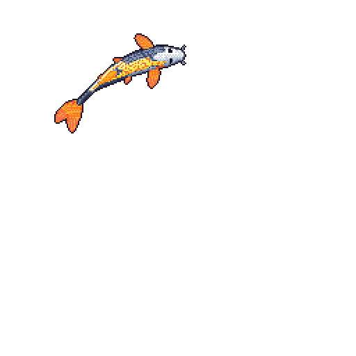

  

## About Me

I'm a Computer Science graduate student at the University of Pittsburgh,
interested in building useful products at the intersection of software, data,
and AI.

This past summer, I interned at **Microsoft**, where I built an MCP server
connecting AI agents to data sources and tools for end-to-end workflows. I've
also worked at **BNY** and **Carnegie Mellon**, building full-stack platforms
and tools that help people make better use of their data.

Outside of software, I teach, mentor, climb, and look for good coffee.

  

## Professional Experience

| Dates | Company | Role |
| --- | --- | --- |
| May 2026 — Aug 2026 | **Microsoft** | Software Engineer Intern · Azure Data Manager for Energy |
| Jun 2025 — Aug 2025 | **BNY** | Software Engineer Intern |
| May 2024 — Dec 2024 | **Carnegie Mellon University** | Software Engineer Intern |
| Jan 2024 — Dec 2025 | **University of Pittsburgh** | Undergraduate Teaching Assistant |
| Apr 2025 — May 2025 | **Stanford Code in Place** | Section Leader |

## Selected Projects

- [Whenly](https://whenlymeet.com) — group scheduling made simple
- [Advera](https://github.com/JonCoulter/advera) — a game for identifying ads
- [Echo](https://github.com/JonCoulter/Echo) — mood-based Spotify playlists

## Let's Connect

- [Website](https://joncoulter.github.io)
- [LinkedIn](https://www.linkedin.com/in/jonathan-coulter-/)
- [Email](mailto:jonacoulter@gmail.com)

My koi changes with my public GitHub activity.
